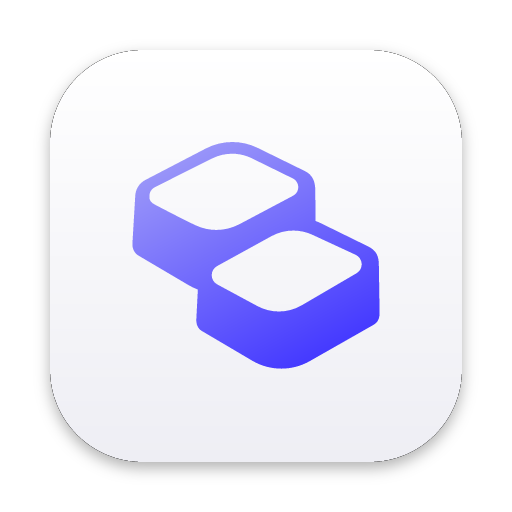
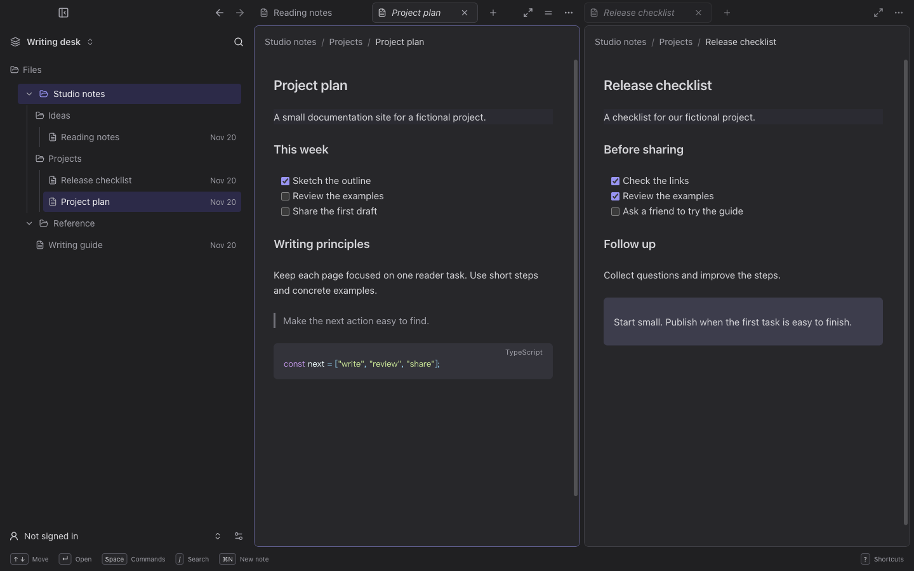

<picture>
  <source media="(prefers-color-scheme: dark)" srcset="./docs/public/logo-dark.png">
  
</picture>

<sub>The logo credit goes to [@Yukaii](https://github.com/Yukaii)</sub>

# HackDesk

[](https://github.com/EastSun5566/hackdesk/releases)
[](https://github.com/EastSun5566/hackdesk/releases)
[](https://github.com/EastSun5566/hackdesk/actions/workflows/build.yml)
[](https://github.com/EastSun5566/hackdesk/blob/main/LICENSE)

> 📝 A hackable HackMD desktop application

Work with HackMD notes and local Markdown vaults.

- **HackMD:** Browse personal and team notes, organize folders, view history, and read opened notes offline.
- **Local Vault:** Open a folder of Markdown files without an account.
- **Markdown:** Link notes, use templates, read books, and present slides.
- **AI and dictation:** Rewrite with your installed Codex or Claude CLI, ask questions across your notes, and dictate on macOS 26 or later.
- **Customize:** Change themes, fonts, editor modes, and shortcuts in Settings.



## Install

[Download HackDesk v2.0.0-beta.13](https://github.com/EastSun5566/hackdesk/releases/tag/v2.0.0-beta.13) for macOS, Windows, or Linux. On macOS, v2 requires macOS 13 or later. Beta builds are unsigned and use manual updates.

Save open notes before upgrading. Back up app data before downgrading: beta.12 cannot read the new multi-folder settings, and versions before beta.10 cannot restore newer tabs, panes, or unsaved drafts.

See the [installation guide](https://hackdesk.eastsun.me/install) for platform steps and the [code signing policy](docs/code-signing-policy.md) for signing status.

Prefer the terminal? [Download the macOS beta with GitHub CLI](https://hackdesk.eastsun.me/install#download-with-github-cli).

Using an agent? Give it the [agent installation guide](https://hackdesk.eastsun.me/install-agent). Machine-readable guides are available at [llms.txt](https://hackdesk.eastsun.me/llms.txt).

### Main previews

[Releases](https://github.com/EastSun5566/hackdesk/releases) also lists `main-<commit>` previews after CI passes. These builds include newer changes, are unsigned, and use manual updates.

### Legacy macOS install

Homebrew currently installs v0.1.5, not the v2 beta:

```sh
brew trust --tap eastsun5566/hackdesk && brew install --cask eastsun5566/hackdesk/hackdesk
xattr -dr com.apple.quarantine "/Applications/HackDesk.app"
```

## Guides

[Get started](docs/intro.md) · [Work with notes](docs/features.md) · [Quick Hack](docs/quick-hack.md) · [Keyboard navigation](docs/keyboard-navigation.md) · [Customize HackDesk](docs/config.md)

The [documentation website](https://hackdesk.eastsun.me) covers beta.13. Screenshots identify the build used for each demonstration.

## Contributing

See the [contribution guide](CONTRIBUTING.md) to run HackDesk locally and check changes.
